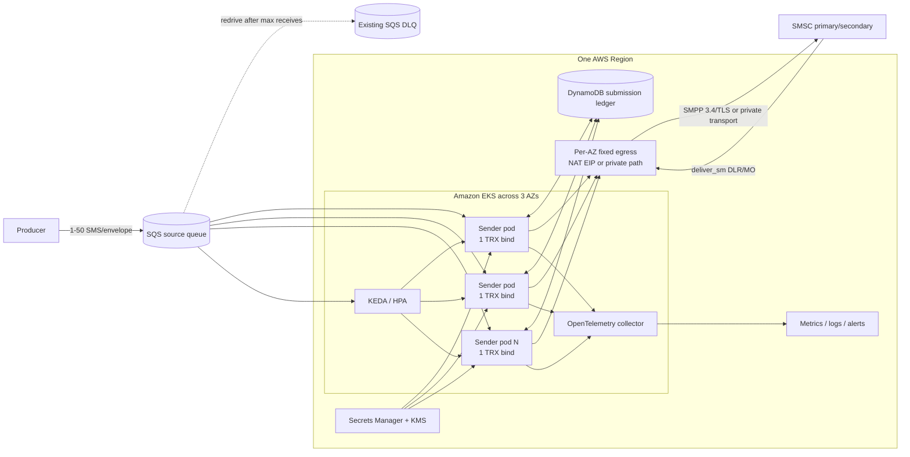
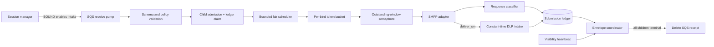

# Target architecture

## 1. Scope and assumptions

The service is an outbound SMS submission worker. Each source SQS message is an envelope containing between 1 and 50 logical SMS items. The worker submits one `submit_sm` PDU per encoded segment unless the carrier explicitly certifies another mechanism. It also receives delivery receipts on the transceiver session, but final handset delivery is not part of source-envelope completion.

Assumptions that must be confirmed before build completion:

- The source is an Amazon SQS **Standard** queue with the existing SQS DLQ attached by a redrive policy.
- Every envelope has a stable `envelopeId`; every child has a stable `smsId` that is unique within the producer's idempotency domain.
- The SMSC permits multiple concurrent transceiver binds for one credential, or supplies a credential per session.
- The carrier publishes aggregate and per-bind TPS, maximum binds, maximum outstanding operations, retryable command statuses, response-time expectations, DLR format, message-ID normalization, segmentation rules, and network security requirements.
- The service is deployed in one AWS Region across three Availability Zones. Cross-region disaster recovery is a separate phase because SMSC routing, source queues, idempotency, and active/active duplicate control must be designed together.

## 2. Quality attributes

| Attribute | Architectural response |
| --- | --- |
| Throughput | 3,000 logical SMS/s starting target; capacity and tests use actual `submit_sm` PDU/s after segmentation. |
| Availability | Three-AZ placement, one session per pod, one-AZ-loss capacity, warm replicas, PDB, controlled rollouts, redundant egress. |
| Integrity | Stable child IDs, conditional DynamoDB ledger, partial-envelope progress, no blind retry of ambiguous submissions. |
| Backpressure | Bounded envelope admission, bounded child channel, per-bind token bucket, outstanding-window semaphore. |
| Operability | Explicit session state, queue and PDU metrics, structured redacted logs, runbooks, controlled DLQ replay. |
| Security | EKS Pod Identity, Secrets Manager, KMS, private AWS endpoints, restricted egress, non-root/read-only containers, signed images. |
| Delivery | Terraform-owned infrastructure; Helm-owned workload; Argo-owned reconciliation; JFrog-owned artifacts; Rancher-owned fleet access/policy. |

Candidate production objectives, to be ratified by product and carrier owners:

- 99.95% monthly availability for accepting eligible work when the source queue, AWS dependencies, and SMSC are available.
- Drain the specified 50,000-envelope daytime burst in less than 20 minutes at the agreed message-size mix.
- Zero silent loss. Every child ends as accepted, permanently rejected, or explicitly unknown/reconciliation-required.
- Alert on any DLQ message and any `UNKNOWN` submission outcome.

## 3. Logical topology



The EKS control plane is managed by AWS. A small managed node group hosts essential cluster services and satisfies Rancher's managed-node prerequisite. Karpenter provisions a dedicated, tainted sender NodePool across all three AZs. Pods use topology-spread constraints for both zone and hostname.

## 4. Pod architecture

Each pod owns one long-lived SMPP transceiver session and the following bounded stages:



### 4.1 Session manager

Use the state machine `DISCONNECTED -> BINDING -> BOUND -> DRAINING`. Reconnect with exponential full jitter and respect the provider's bind-attempt limit. Readiness is true only when the session is bound and the pod has admission capacity. Liveness tests the worker's own event loop, not the remote SMSC; restarting every pod during a carrier outage would amplify the outage into a bind storm.

All SMPP timers are configurable. The SMPP 3.4 specification recommends configurable session-init, enquire-link, inactivity, and response timers. Sequence numbers correlate asynchronous requests and responses, and responses may arrive out of order. The specification leaves the maximum outstanding operations to the SMSC and gives a guideline of no more than ten, so the configured window must come from the carrier profile and qualification tests—not a guessed high value. See the [SMPP 3.4 specification](https://smpp.org/SMPP_v3_4_Issue1_2.pdf), sections 2.6/2.7, 3.2.1, and 7.2.

### 4.2 SQS receive pump

- Use the low-level AWS SDK so downstream PDU credits can control intake precisely.
- Long poll for 20 seconds and request at most ten envelopes, the SQS API maximum. Reserve downstream capacity before receiving; do not automatically admit 500 children simply because the API can return ten 50-item envelopes. [AWS `ReceiveMessage`](https://docs.aws.amazon.com/AWSSimpleQueueService/latest/APIReference/API_ReceiveMessage.html)
- Start with a 120-second visibility timeout and heartbeat around every 30 seconds while an envelope is actively owned. Tune from measured P99 completion time and stop extending after a bounded maximum age. AWS documents both at-least-once delivery during visibility and the need to extend visibility for variable processing. [AWS visibility guidance](https://docs.aws.amazon.com/AWSSimpleQueueService/latest/SQSDeveloperGuide/sqs-visibility-timeout.html)
- Delete an envelope only when every child/segment has reached a durable submission-stage terminal state.
- Do not receive while unbound, the internal channel is full, DynamoDB is unavailable, or a carrier throttle circuit is open.

### 4.3 Bounded submit path

Use two independent gates per bind:

1. A token bucket limits `submit_sm` starts to the contractual per-bind allocation. Protocol responses such as `deliver_sm_resp` and `enquire_link` must not consume submit tokens.
2. A semaphore limits unacknowledged requests to the carrier-approved outstanding window.

The scheduler interleaves children from different envelopes so one 50-item envelope cannot monopolize the session. All queues and channels have hard capacities. There is no unbounded `Task.WhenAll`, task creation, executor, or goroutine fan-out.

On `ESME_RTHROTTLED` or the provider's queue-full status, reduce the effective send rate and retry with full jitter. A conservative additive-increase/multiplicative-decrease controller can recover gradually. Permanent validation/address/encoding failures become terminal business rejections. Provider-specific statuses must be configuration/data, not scattered conditionals.

### 4.4 Envelope completion

`submit_sm_resp` success means the SMSC accepted the PDU; it does not mean the handset received it. The source SQS envelope completes after every child segment is either:

- `ACCEPTED`, with the normalized SMSC message ID persisted;
- `PERMANENT_REJECTED`, with a bounded reason code; or
- `UNKNOWN`, durably quarantined for reconciliation under the approved ambiguity policy.

DLRs arrive later through `deliver_sm`, may be duplicated or out of order, and may use text or TLV formats. Acknowledge them quickly, normalize the provider message ID, and update a separate delivery state on the ledger. Never wait for DLRs before deleting the source envelope.

Do not use `submit_multi` merely because an SQS envelope contains 50 recipients. It is permitted only if the carrier certifies its throughput, billing, error, and DLR behavior.

## 5. Submission ledger and delivery semantics

SQS Standard queues are at-least-once. SMPP submission is an external side effect, and there is no transaction that atomically combines an SMSC acceptance, a DynamoDB update, and an SQS delete. Exactly-once SMS delivery therefore cannot be promised.

The ledger key is the producer's stable `smsId` (namespaced by tenant/source if necessary). A record contains:

| Field | Purpose |
| --- | --- |
| `smsId` | Partition key and idempotency key. |
| `envelopeId`, `itemIndex` | Source traceability. |
| `payloadHash` | Detect accidental reuse of an ID for different content without storing message text. |
| `state` | `CLAIMED`, `SEND_STARTED`, `ACCEPTED`, `PERMANENT_REJECTED`, or `UNKNOWN`. |
| `leaseOwner`, `leaseUntil` | Conditional claim/recovery. |
| `segmentCount`, `acceptedSegments` | Per-segment progress. |
| `smscMessageIds` | Encrypted/controlled values used for DLR correlation. |
| `attemptCount`, `lastStatus`, timestamps | Audit and retry policy. |
| `expiresAt` | DynamoDB TTL beyond message validity plus the DLR/replay retention window. |

Use conditional writes for claims and state transitions. Redelivery skips terminal children with the same payload hash; a hash mismatch is a permanent contract violation.

The unavoidable ambiguity is:

```text
SMSC accepts submit_sm -> connection/pod fails before response is durably recorded
```

An expired `SEND_STARTED` claim becomes `UNKNOWN`; it must not be blindly resent by default. Preferred resolution order:

1. Carrier-supported idempotency/client-reference contract.
2. Carrier query/reconciliation using the provider's message lookup semantics.
3. Manual/business policy: choose possible duplicate or possible non-delivery.

The SMPP `user_message_reference` TLV is a useful correlation field but is only a two-octet reference in SMPP 3.4 and is not, by itself, an idempotency guarantee. Contract its semantics with the carrier.

The existing DLQ remains the poison/exhausted-envelope safety net. It is not the child-progress database. A redriven envelope always consults the ledger and sends only eligible unresolved children.

## 6. Availability and lifecycle

- Run a Kubernetes `Deployment`, not a StatefulSet, when parallel binds can reuse credentials. Use a StatefulSet only if sessions require ordinal-specific credentials or stable identity.
- Spread pods evenly across zones and nodes with `DoNotSchedule` constraints for the production pool. AWS recommends multiple replicas, PodDisruptionBudgets, and topology spread for highly available EKS applications. [AWS EKS HA guidance](https://docs.aws.amazon.com/eks/latest/best-practices/application.html)
- Provision normal active capacity plus enough reserve to continue the target rate after loss of one AZ. For three equal AZs, the starting formula is `ceil(activeBinds * 3 / 2)`, rounded to a multiple of three.
- Set a PDB with `maxUnavailable: 1` and a dedicated PriorityClass. Preserve one spare carrier login for `maxSurge: 1`; if no extra bind is allowed, use `maxSurge: 0`, `maxUnavailable: 1` and accept reduced rollout capacity.
- Keep a warm minimum of at least three and normally the known daytime load requirement. Pre-scale before scheduled campaigns. Use a 5-10 minute scale-down stabilization/cooldown to avoid connection churn.
- Use a small managed system node group plus Karpenter for application nodes. Pin tested AMIs and configure NodePool disruption budgets. AWS recommends PDBs and topology spread with Karpenter. [AWS Karpenter guidance](https://docs.aws.amazon.com/eks/latest/best-practices/karpenter.html)

Graceful termination sequence:

1. Mark the pod unready and stop SQS receives.
2. Close the admission writer and continue visibility heartbeats.
3. Drain outstanding submissions within the application shutdown deadline.
4. Persist terminal outcomes and delete only completed envelopes.
5. Leave incomplete envelopes undeleted so they reappear.
6. Send `unbind`, close the SMPP connection, and exit.

Start with a 120-second Kubernetes termination grace period and a 105-second application shutdown deadline; tune from tests.

## 7. Scaling policy

Use one KEDA `ScaledObject` to create the HPA. Do not add a competing hand-authored HPA.

- SQS `queueLength` is measured in envelopes, not logical SMS or segments. The target must be derived from measured per-pod envelope service rate and acceptable queue delay.
- KEDA includes visible plus in-flight SQS messages by default. Bounded prefetch is therefore essential so in-flight remains a useful work signal. [KEDA SQS scaler](https://keda.sh/docs/2.20/scalers/aws-sqs/)
- `minReplicaCount` is the warm HA/daytime floor; `maxReplicaCount` is no greater than the carrier's simultaneous-bind allowance and global TPS budget.
- Scale up quickly but in controlled steps with randomized bind startup. Scale down slowly.
- Queue age is an SLO signal. Add a custom Prometheus/CloudWatch trigger later if oldest-message age or admitted segment backlog provides a better scaling signal than depth.
- CPU is a safety trigger, not the primary scaler; throughput is normally limited by carrier TPS, window, and RTT.

## 8. Network and security

- Place worker nodes in private subnets across three AZs. Give each AZ deterministic outbound identity through an allowlisted NAT EIP, or use the carrier-approved redundant VPN/Direct Connect/private path. Test zone-route failure. Do not route all AZs through one NAT gateway.
- Prefer SMPP over TLS when the provider supports it. If it only offers plaintext SMPP, require an approved private encrypted transport; do not send credentials or message content over the public internet in cleartext.
- Use VPC endpoints for SQS, DynamoDB, Secrets Manager, KMS, STS/Pod Identity where applicable, and telemetry services. Restrict security-group and Kubernetes NetworkPolicy egress to those endpoints, DNS, JFrog image access, and the SMSC addresses/ports.
- Use EKS Pod Identity with a dedicated service account and least privilege. AWS recommends Pod Identity for new supported workloads and one role per application. [AWS EKS identity guidance](https://docs.aws.amazon.com/eks/latest/best-practices/identity-and-access-management.html)
- Grant only source `ReceiveMessage`, `DeleteMessage`, `ChangeMessageVisibility`, and `GetQueueAttributes`; required KMS decrypt; ledger operations; secret read; and telemetry writes. The runtime has no DLQ replay permission.
- Store SMPP credentials and the commercial library license in Secrets Manager, synchronized or mounted at runtime. Never place them in Helm values, Git, an image layer, Terraform variables, or Terraform state.
- Run as non-root with a read-only root filesystem, dropped Linux capabilities, seccomp runtime default, resource requests/limits, and no service-account-token automount unless required by the credential mechanism.
- Generate an SBOM, scan with JFrog Xray, sign the OCI image and Helm provenance, admit only approved digests, and retain build evidence.

## 9. Observability

Use OpenTelemetry `Meter`/`ActivitySource` and structured logs. Export through an in-cluster collector to the enterprise metrics, logging, and tracing platform.

Required metrics:

- SQS visible/in-flight depth, oldest-message age, receive count, visibility extensions/failures, and DLQ depth.
- Logical SMS/s, segment multiplier, attempted/accepted/rejected PDU/s, response latency P50/P95/P99.
- Bind state/age, successful enquire-link age, reconnect/bind-failure count.
- Configured/effective TPS, outstanding-window used/free, throttle count, response timeouts.
- Bounded-channel depth, admitted envelopes/segments, ledger conditional failures/dedupe hits.
- `UNKNOWN` outcomes, permanent rejections by bounded status class, DLR state/latency.
- CPU, working set, GC, socket errors, and pod/node/AZ distribution.

Never use phone numbers, message bodies, SMSC message IDs, or high-cardinality business IDs as metric labels. Logs omit message bodies, tokenize or hash identifiers, and apply retention/access policies suitable for personal data. Trace sampling must remain bounded at peak.

Page immediately on no bound sessions, oldest-message-age SLO breach, any DLQ item, sustained carrier throttling, rising `UNKNOWN` outcomes, or loss of one-AZ capacity.

## 10. Open architecture gates

No production throughput commitment is valid until the carrier answers:

- Aggregate and per-bind TPS; maximum simultaneous binds per credential and source IP.
- Approved outstanding window and P95/P99 `submit_sm_resp` latency.
- TRX support versus separate TX/RX binds; primary and DR endpoint behavior.
- TLS/private connectivity and source-IP allowlist requirements.
- GSM-7 extension, UCS-2, national language, UDH/SAR TLV, and `message_payload` rules.
- DLR request flags, format, routing across multiple binds, message-ID normalization, and retention.
- Exact retryable/permanent command status table and throttle recovery requirements.
- Whether a provider idempotency field or reliable query/reconciliation service exists.

These are procurement/interface-contract questions, not application tuning details.
