# Platform and delivery model

## 1. Tool ownership

The named tools are complementary. Avoid allowing more than one of them to reconcile the same resource.

| Tool | Owns | Must not own |
| --- | --- | --- |
| Terraform | AWS accounts/network, EKS, managed node group, Karpenter prerequisites, add-ons, IAM/Pod Identity, KMS, VPC endpoints, DynamoDB ledger, alarms, secret metadata, source queue/DLQ imports and redrive configuration | Application Deployments or day-two Helm releases |
| JFrog Artifactory/Xray | NuGet/Maven/Go proxy, OCI image and Helm OCI repositories, build-info, SBOM, vulnerability/license gates, promotion | Live-cluster deployment state |
| Helm | Namespaced workload package: Deployment, Service, service account, KEDA ScaledObject, PDB, NetworkPolicy, ExternalSecret/CSI objects, ServiceMonitor, dashboards/rules | AWS infrastructure or mutable production secrets |
| Argo CD | Declarative reconciliation of approved Helm chart versions and environment values from Git; drift detection/self-heal | Building images or applying Terraform |
| Rancher | Register existing EKS clusters, fleet visibility, SSO/RBAC, policy/governance, operator access and cluster health | Provisioning the same EKS resources already owned by Terraform; application delivery already owned by Argo |

Terraform uses an encrypted/versioned S3 backend with S3 lockfiles and path-scoped IAM. DynamoDB-based state locking is deprecated in current Terraform S3 backend guidance. [Terraform S3 backend](https://developer.hashicorp.com/terraform/language/backend/s3)

Rancher registers the Terraform-provisioned EKS cluster rather than creating a second source of truth. Current Rancher guidance requires at least one managed node group when registering EKS, which is also useful for stable system workloads. [Rancher cluster registration](https://ranchermanager.docs.rancher.com/v2.12/how-to-guides/new-user-guides/kubernetes-clusters-in-rancher-setup/register-existing-clusters)

## 2. Repository model

Use separate repositories or clearly protected top-level domains:

```text
sender-service/
  src/                       application and protocol adapter
  tests/                     unit, integration, load clients
  chart/                     Helm chart source
  local/                     Compose/Testcontainers harness

sender-infrastructure/
  modules/                   reusable Terraform modules
  live/dev/
  live/test/
  live/prod/

sender-gitops/
  applications/              Argo Applications/ApplicationSets
  environments/dev/
  environments/test/
  environments/prod/         image digest, chart version, values only
```

This architecture repository may become the service repository during implementation. Production Terraform and GitOps state should still have distinct approvals and write permissions.

## 3. Terraform layers

Keep modules relatively flat and use composition, following HashiCorp's standard module structure. [Terraform module structure](https://developer.hashicorp.com/terraform/language/modules/develop/structure)

Suggested layers:

1. `network`: three-AZ VPC, private node subnets, per-AZ NAT/EIP or private carrier path, endpoints, flow logs.
2. `eks`: control plane, access entries, small managed system node group, Pod Identity agent, Karpenter prerequisites, logging.
3. `data-plane`: import/reference source SQS and DLQ, validate redrive settings, DynamoDB ledger with PITR/TTL/encryption, KMS keys, CloudWatch alarms.
4. `identity`: application Pod Identity role, KEDA identity, External Secrets identity, narrowly scoped policies.
5. `platform-bootstrap`: Argo CD, KEDA, External Secrets/CSI, telemetry and policy components where the enterprise platform does not supply them.
6. `rancher-registration`: declarative registration/token workflow if supported by the enterprise Rancher operating model; otherwise an auditable one-time runbook.

State is split by environment and blast radius. Production apply requires reviewed plans and short-lived federated credentials. Terraform does not receive SMPP secret values—only secret ARNs/names and resource policies.

## 4. Artifact flow

```mermaid
flowchart LR
    DEV[Source commit] --> CI[Enterprise CI]
    CI --> U[Unit + integration + SAST]
    U --> IMG[Build minimal .NET image]
    IMG --> JF[JFrog Artifactory]
    JF --> XR[Jfrog Xray + license gate]
    XR --> SB[SBOM + signature + build-info]
    SB --> PROM[Promote immutable digest/chart]
    PROM --> PR[GitOps environment PR]
    PR --> ARGO[Argo CD]
    ARGO --> HELM[Helm render/apply]
    HELM --> EKS[Amazon EKS]
    EKS --> R[Rancher visibility/policy]
```



Rules:

- Pin every base image and application image by digest. Do not deploy `latest`.
- JFrog remote repositories proxy public NuGet/Maven/Go sources; builds do not fetch directly from the internet.
- Publish the application image and Helm chart to JFrog OCI repositories with build-info, provenance, and SBOM.
- Xray/license policy blocks promotion, not merely reports after deployment.
- The GitOps PR changes the immutable image digest/chart version. CI never needs cluster-admin or calls `kubectl` in production.
- Argo uses automated sync/self-heal for lower environments. Production uses an approved promotion PR and controlled sync window; pruning remains enabled only with resource protections and tested recovery.
- Use Argo sync waves for prerequisites, secret references, workload, then monitoring/tests. Argo orders lower-numbered waves first. [Argo CD sync waves](https://argo-cd.readthedocs.io/en/stable/user-guide/sync-waves/)
- Roll back by promoting a previously signed image/chart/config combination. Schema/data migrations must be backward compatible because the SMPP worker rolls gradually.

## 5. Helm chart contract

The chart exposes bounded, validated values rather than arbitrary environment-variable maps:

```yaml
image:
  repository: jfrog.example.com/smpp-prod/sender
  digest: sha256:required

replicas:
  minimum: 3
  maximum: 30  # never above contracted binds

smpp:
  bindsPerPod: 1
  bindMode: transceiver
  perBindTps: required
  outstandingWindow: required
  responseTimeout: required
  enquireLinkInterval: required
  endpointSecretRef: smpp-sender/production

sqs:
  queueUrl: required
  maxEnvelopesPerReceive: 2
  waitTimeSeconds: 20
  visibilityTimeoutSeconds: 120
  visibilityHeartbeatSeconds: 30

admission:
  maxActiveEnvelopes: required
  maxBufferedPdus: required

autoscaling:
  queueLengthPerPod: required
  cooldownSeconds: 600
  scaleOnInFlight: true

rollout:
  maxSurge: 1       # requires a spare carrier bind
  maxUnavailable: 0
```

Admission policy rejects `bindsPerPod != 1`, mutable image tags, missing resource requests/limits, privileged containers, plaintext credentials, or replicas above the contracted bind ceiling.

The chart creates:

- Deployment with startup/readiness/liveness probes and 120-second termination grace;
- ClusterIP Service for health/metrics only;
- dedicated ServiceAccount associated to EKS Pod Identity outside Kubernetes;
- KEDA ScaledObject (the only HPA owner);
- PDB and zone/hostname topology constraints;
- default-deny ingress and allowlisted egress NetworkPolicies;
- ExternalSecret/CSI reference, never secret material;
- ServiceMonitor/PodMonitor and alert rules when that CRD is installed.

## 6. Environment promotion

| Environment | Purpose | Minimum evidence |
| --- | --- | --- |
| Local | Functional protocol/SQS/error semantics | Unit/property tests and programmable harness scenarios |
| Dev EKS | AWS integration, Pod Identity, charts, Argo, Rancher | Successful smoke and fault suite |
| Performance EKS | Exact image/node/network and carrier simulator/stub | 1x/1.5x/stress, one-AZ loss, 1-hour soak |
| Carrier certification | Real endpoint and interface profile | Encoding/TLV/status/DLR/reconnect certification |
| Production canary | Small controlled share below carrier limits | Stable SLOs and no new unknown/duplicate class |
| Production | Approved digest/config | 24-hour endurance evidence and rollback rehearsal |

Feature flags/configuration can select provider profiles, but the rate, window, retry classification, and endpoint changes are production-controlled configuration releases with the same review as code.

## 7. Operational access

- Human access enters through enterprise SSO to Rancher and AWS IAM Identity Center; no shared kubeconfigs or static IAM users.
- Rancher roles are least privilege and namespace-scoped for service operators. Break-glass cluster access is audited, time-limited, and tested.
- Argo is the only normal workload writer. A break-glass manual change is followed by a Git reconciliation or is automatically reverted by self-heal.
- Production DLQ replay is a separate role/tool, never a permission on the sender pods. It performs a dry-run reconciliation against the ledger and records an approval/audit ID.
- Secret rotation supports overlapping old/new credentials or a coordinated rolling rebind, depending on carrier capability.

## 8. Platform failure modes

| Failure | Required behavior |
| --- | --- |
| JFrog unavailable | Running workloads continue; new nodes need an image-cache/availability plan; deployment is blocked safely. |
| Argo unavailable | Running workloads continue; no drift reconciliation; page platform owner. |
| Rancher unavailable | Running EKS/Argo workloads continue; operator UI/access is degraded, not the SMS path. |
| Terraform backend unavailable | No infrastructure changes; runtime unaffected. Never bypass state locking. |
| One AZ/NAT lost | Other AZs retain target session capacity and approved egress paths. |
| Karpenter delayed | Warm node/session floor carries forecast load; backlog remains durable. |

None of Rancher, JFrog, Terraform, Argo, or Helm is in the live SQS-to-SMPP message path.
