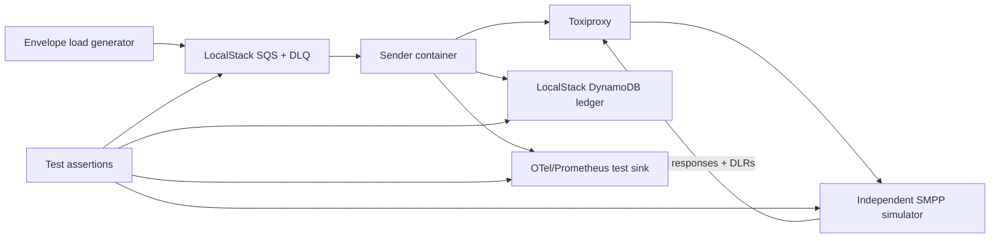

# Local and production test strategy

## 1. Test topology

The local harness is a reproducible Docker Compose or Testcontainers environment:



Use two SMPP test layers:

1. A fast programmable .NET harness built with the selected library's server API for deterministic component tests.
2. An independent Java jSMPP or Melrose/SMPPSim-compatible black-box simulator so the client and server do not share the same codec defects. jSMPP includes a server simulator example. [jSMPP simulator](https://github.com/opentelecoms-org/jsmpp/blob/master/jsmpp-examples/src/main/java/org/jsmpp/examples/SMPPServerSimulator.java)

Toxiproxy injects latency, resets, timeouts, and half-open connections independently of the SMPP simulator.

LocalStack validates application behavior, not AWS service capacity, exact SQS timing, IAM/Pod Identity, KEDA, NAT, or EKS behavior. Those require non-production AWS environments.

## 2. Harness controls

The simulator exposes test-only controls for:

- bind accept/reject, delayed bind response, session limit, primary/secondary endpoints;
- per-bind/global TPS and `ESME_RTHROTTLED` patterns;
- configurable response latency and deterministic out-of-order `submit_sm_resp`;
- permanent error by destination/payload marker;
- no response, socket drop before parse, drop after accept/before response, server `unbind`;
- enquire-link response suppression and inactivity close;
- unique/variant SMSC message-ID formats;
- immediate/delayed/duplicate/out-of-order/malformed DLRs in text and TLV form;
- MO message injection;
- UDH/SAR/message-payload recording and PDU capture without real personal data.

Every control has a deterministic seed so failures are reproducible.

## 3. Test pyramid

### Unit, property, and fuzz tests

- JSON Schema and semantic validation: 1-50 children, stable IDs, payload-hash reuse detection.
- GSM-7 basic and extension-table septet counting, UCS-2, emoji/non-BMP policy, segment boundaries.
- UDH versus SAR TLV construction and provider profile rules.
- TON/NPI, source address, validity, registered delivery, and optional TLVs.
- SMPP command-status classification and bounded exponential/full-jitter schedules.
- Ledger conditional transitions, expired claims, dedupe skip, and `UNKNOWN` policy.
- Envelope completion barrier with mixed accepted, permanent, transient, and unknown children.
- Cancellation, channel bounds, fair scheduling, and shutdown deadlines.
- PDU/parser fuzzing and malformed DLR handling.

### Local integration tests

- One valid 50-child envelope reaches 50 accepted terminal records and is deleted.
- A permanent invalid child plus 49 valid children does not resend the valid 49.
- Duplicate SQS delivery and visibility expiry suppress known accepted children.
- Transient throttling slows admission without unbounded memory or hot retry.
- Delayed/out-of-order responses correlate by sequence number.
- Connection loss before any socket write is safely retryable.
- Connection loss after send/accept creates `UNKNOWN` and does not blind retry.
- Bind rejection makes readiness false and stops SQS intake without a restart storm.
- DLR before/after envelope completion, duplicated DLR, unknown message ID, and format variants.
- SIGTERM stops intake, keeps visibility heartbeats, drains, persists, unbinds, and exits.
- Hard kill mid-envelope causes redelivery and ledger-based partial recovery.
- A poison envelope reaches the configured DLQ; replay skips terminal children.
- Secret rotation/rebind does not expose credentials in logs or process diagnostics.

### EKS integration and chaos tests

- Pod Identity permissions allow only the required queue, ledger, secret, KMS, and telemetry actions.
- KEDA scaling respects the carrier bind maximum and maintains the warm floor.
- Topology spread is even; removal of one node and then one AZ meets the approved degraded/target capacity.
- NAT EIP/source allowlists and primary/secondary carrier routing work from every AZ.
- Rolling deployment honors bind surge limits and does not duplicate active work.
- Karpenter consolidation/node rotation respects PDB and drain behavior.
- SQS visibility, native DLQ redrive, CloudWatch alarms, and DynamoDB throttling/failure behavior match design.
- NetworkPolicies and security groups block all unapproved destinations.

## 4. Load suites

The generator produces versioned 50-child envelopes with a realistic encoding/segment distribution and stable IDs.

| Suite | Load | Duration / fault | Pass condition |
| --- | --- | --- | --- |
| Baseline | Calculated target PDU/s | 30 min | Stable latency/rate; zero silent loss; bounded queues/memory |
| Qualification | 1.5x target | 60 min | Controlled backpressure; no leaks; backlog recovers within SLO |
| Burst | 50,000 full envelopes | Instant/realistic arrival, drain <20 min | 2.5m children reconcile; segmented target sustained |
| Stress | Increase until controlled saturation | 30 min | No crash/unbounded growth; throttle/backpressure visible |
| One-AZ loss | Target load, remove one-third of pods/nodes | 30 min | Remaining capacity meets the agreed objective |
| Carrier impairment | 100-500 ms RTT, throttle, drops | 60 min | Correct rate adaptation and ambiguity classification |
| Endurance | Forecast peak/profile | 24 h | No monotonic heap/socket/task/ledger growth; reconnect stable |

Run with the exact production runtime, SMPP package, image digest, Helm chart, logging level, and OpenTelemetry configuration. A laptop result is not a production capacity result.

## 5. Reconciliation oracle

For every test run, assert:

```text
input children
= accepted logical children
+ permanently rejected children
+ explicitly unknown children
```

Also reconcile PDU/segment counts separately:

```text
attempted segments
= accepted segments
+ permanently rejected segments
+ safely retryable pre-send failures
+ unknown post-send outcomes
```

The simulator's accepted-PDU log, worker ledger, SQS/DLQ state, and metrics are four independent evidence sources. A count mismatch fails the run even if throughput passed.

## 6. Performance gates

- P95/P99 `submit_sm_resp` latency stays within the carrier profile at the configured window.
- No channel exceeds its configured capacity; no unbounded tasks/threads are created.
- No permanent increase in memory, socket count, outstanding requests, or visibility heartbeats after load stops.
- Effective PDU rate never exceeds the contractual aggregate or per-bind limit outside an intentional negative test.
- All throttle, timeout, reconnect, permanent rejection, and unknown outcomes appear in bounded metrics and ledger states.
- Logs and traces contain no message body or raw MSISDN.
- Test artifacts include seed/configuration, image digest, chart version, node shape, result summary, and raw metrics retention link.

## 7. Local developer workflow target

Implementation should provide these stable commands through the repository build wrapper:

```text
./build test                 unit/property tests
./build integration-up       start SQS/DynamoDB/SMPP/Toxiproxy harness
./build integration          run deterministic fault suite
./build load --profile burst run the 50k-envelope scenario
./build integration-down     stop the harness and preserve test reports
```

On Windows, expose equivalent PowerShell entry points. CI invokes the same containerized workflow. Do not make developers install an SMSC, AWS CLI, or language-specific simulator globally.
